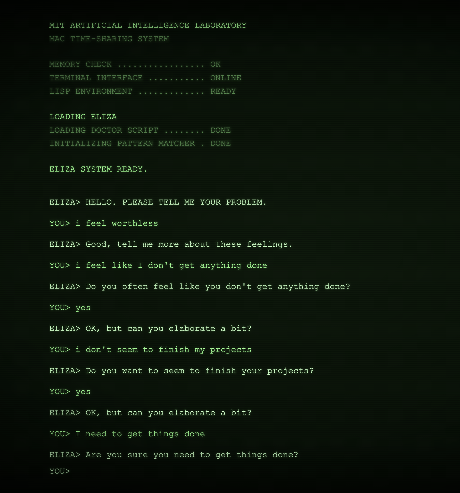

The post explores how [ELIZA](https://en.wikipedia.org/wiki/ELIZA){:target="_blank"}, an early chatbot from the 1960s, generated seemingly conversational replies. Rather than understanding the user's messages, it relied on matching patterns and substituting words to produce responses.

Python's Natural Language Toolkit (NLTK) includes an ELIZA implementation that can be used directly:

```python
from nltk.chat.eliza import eliza_chatbot

print(eliza_chatbot.respond("hello"))
# Hello, how are you feeling today?
```

I went on to build a web interface around this chatbot, using a visual style inspired by vintage CRT terminals and teletypes, and tested it with deliberately emotional messages.

Here is a screenshot of the web interface



[View the source code on GitHub](https://github.com/bmwasaru/eliza_chat){:target="_blank"}
